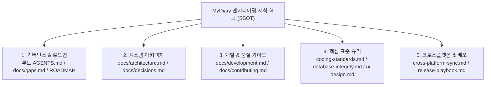

# 📚 MyDiary 모바일 공식 문서 체계 및 인덱스 (Documentation Hub)

> **문서 목적**: MyDiary 스마트폰 앱(React Native / Expo) 프로젝트의 설계 철학, 아키텍처, 기능 격차(Gaps), 엔지니어링 표준을 집대성한 단일 진실 공급원(SSOT) 공식 통합 문서 허브(Sitemap)입니다.  
> **독자 대상**: 총괄 개발자(`Sung Baekjin`), 오픈소스 기여자, 그리고 모든 AI 에이전트(Claude Code, GitHub Copilot, Cursor, Gemini, Antigravity, Windsurf 등).  
> **최신 개정판**: 2026-10-21  
> **총괄 관리자**: 성백진 (`Sung Baekjin` / `sbjwin4271@gmail.com`)

---

## 🧭 통합 문서 계층 구조 (Documentation Hierarchy)

MyDiary 모바일 프로젝트 문서는 특정 AI 도구에 종속되지 않는 **도구 중립적(Tool-Agnostic) 하네스 원칙**에 따라 모든 엔지니어링 지식을 프로젝트 루트 [AGENTS.md](file:///d:/development/mydiary/AGENTS.md) 및 [docs/](file:///d:/development/mydiary/docs)에 표준화하여 관리합니다.

---

## 📑 핵심 문서 상세 인덱스

| 구분 | 문서명 | 링크 | 핵심 내용 및 목적 |
|---|---|---|---|
| **거버넌스** | 마스터 에이전트 가이드 | [AGENTS.md](file:///d:/development/mydiary/AGENTS.md) | 모든 AI 모델 및 기여자가 최우선으로 읽어야 하는 행동 헌장, 골든 룰, 게이트 |
| **작업 선정** | 잔여 기능 격차 & 스코어카드 | [docs/gaps.md](file:///d:/development/mydiary/docs/gaps.md) | 모바일 핵심 기능 격차 랭킹(G1~G5), 정량적 스코어카드, 작업 우선순위 매트릭스 |
| **아키텍처** | 시스템 구조 & 스토리지 | [docs/architecture.md](file:///d:/development/mydiary/docs/architecture.md) | React 19 / RN 0.86 / Expo 57, 네비게이션 구조, HWPX 생성 파이프라인 |
| **환경 셋업** | 개발 & 디버그 가이드 | [docs/development.md](file:///d:/development/mydiary/docs/development.md) | Expo 로컬 실행, Android 에뮬레이터/실기기 디버깅, 테스트 가이드 |
| **기여 표준** | 기여 & 체크리스트 | [docs/contributing.md](file:///d:/development/mydiary/docs/contributing.md) | 신규 화면/컴포넌트 추가 7단계 체크리스트, 품질 게이트 통과 절차 |
| **코드 표준** | 코딩 표준 & 제약조건 | [docs/coding-standards.md](file:///d:/development/mydiary/docs/coding-standards.md) | 순수 JS + @types, 변수명 일관성, 최소 침습적 수정(Minimal-Diff) |
| **데이터** | DB 무결성 & 백업 | [docs/database-integrity.md](file:///d:/development/mydiary/docs/database-integrity.md) | AsyncStorage 스키마, 학생-일지 연쇄 삭제(Cascade Delete), 백업 JSON 호환 |
| **디자인** | UI 디자인 시스템 | [docs/ui-design.md](file:///d:/development/mydiary/docs/ui-design.md) | `src/theme.js` 디자인 토큰, 색상 팔레트, 모달 및 터치 가이드라인 |
| **의사결정** | 아키텍처 결정 기록 (ADR) | [docs/decisions.md](file:///d:/development/mydiary/docs/decisions.md) | 기술 스택 및 라이브러리 선정 이유, 보안 및 호환성 결정 히스토리 |
| **플랫폼 연동**| 크로스플랫폼 동기화 | [docs/cross-platform-sync.md](file:///d:/development/mydiary/docs/cross-platform-sync.md) | 모바일(`mydiary`) ↔ 데스크톱(`mydiary-desktop`) 간 양방향 동기화 표준 |
| **배포** | 릴리즈 플레이북 | [docs/release-playbook.md](file:///d:/development/mydiary/docs/release-playbook.md) | 5개 파일 버전 동기화, 시맨틱 버저닝, GitHub Actions 자동 배포 파이프라인 |
| **세션 인계** | 개발자 작업 로그 | [log/devlog.md](file:///d:/development/mydiary/log/devlog.md) | 다중 AI 모델 간 세션 단절 방지 및 작업 진행 상태 인계장 |

---

## 🛠️ 작업 시 필수 확인 흐름 (3단계 하네스)

1. **작업 착수 전**: [docs/gaps.md](file:///d:/development/mydiary/docs/gaps.md)에서 가장 우선순위가 높은 과제를 확인하고 착수.
2. **코드 구현 중**: [docs/coding-standards.md](file:///d:/development/mydiary/docs/coding-standards.md) 및 [docs/ui-design.md](file:///d:/development/mydiary/docs/ui-design.md) 준수.
3. **작업 완료 전**: `npm run gate` (린트 + Jest 27개 테스트 + 9대 감사) 통과 및 [log/devlog.md](file:///d:/development/mydiary/log/devlog.md) 기록.
