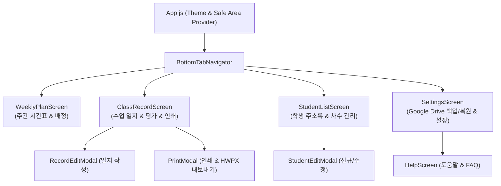
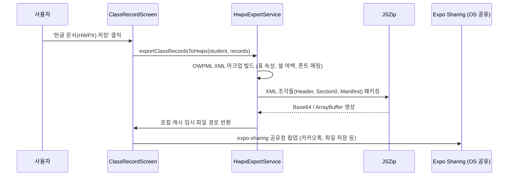

# 🏛️ MyDiary 모바일 시스템 아키텍처 (Mobile System Architecture)

> **문서 목적**: MyDiary 스마트폰 앱의 전체 런타임 아키텍처, 컴포넌트 계층도, 스토리지 모델 및 파일 생성 파이프라인을 규정하는 공식 설계 문서입니다.  
> **최종 갱신일**: 2026-10-21  
> **총괄 관리자**: 성백진 (`Sung Baekjin` / `sbjwin4271@gmail.com`)

---

## 1. 기술 스택 (Technology Stack)

* **Core Runtime**: React 19.2.3, React Native 0.86.0 (New Architecture 지원)
* **Application Framework**: Expo SDK 57.0.0 (`expo`, `expo-file-system`, `expo-sharing`, `expo-print`)
* **Navigation**: React Navigation v7 (`@react-navigation/native`, `@react-navigation/bottom-tabs`, `@react-navigation/stack`)
* **Local Database**: `@react-native-async-storage/async-storage` 2.2.0 (로컬 키-값 영속성 스토리지)
* **HWPX Document Engine**: `jszip` 3.10.1 (국가 표준 KS X 6101 OWPML XML 패키징 엔진)
* **Cloud & Auth**: `@react-native-google-signin/google-signin` (Google Drive 백업 연동)
* **Quality & Test**: Jest 29, jest-expo 57, ESLint 8, Prettier 2

---

## 2. 프로젝트 디렉터리 맵 (Workspace Map)

```text
mydiary/
├── src/
│   ├── components/         # 재사용 가능한 UI 컴포넌트 (ConfirmModal, Separator, Card 등)
│   ├── database/           # AsyncStorage 접근 중앙 헬퍼 (Database.js - 단일 진입점)
│   ├── screens/            # 6대 주요 기능 화면 (WeeklyPlan, ClassRecord, StudentList 등)
│   ├── services/           # 외부 I/O 및 내보내기 엔진 (HwpxExportService, BackupService 등)
│   ├── theme.js            # 공식 디자인 토큰 (theme 객체: 색상, 여백, 모서리 곡률)
│   └── utils/              # 순수 유틸리티 함수 (dateUtils, stringUtils - DRY 원칙)
├── __tests__/              # Jest 단위 및 통합 테스트 스위트 (27개 테스트)
├── assets/                 # 앱 아이콘, 스플래시 이미지, 폰트 에셋
├── docs/                   # [공용 SSOT] 엔지니어링 지식 허브 & 하네스
├── hwpx-templates/         # HWPX OWPML 기본 XML 골격 (header, content, version)
├── log/                    # [공용 세션 인계장] devlog.md
├── scripts/                # 하네스 자동화 도구 (git-achievement.js, audit-project.js 등)
├── .agents/                # [성백진님 전용] 1:1 개인 하네스 및 6대 메타 스킬
├── AGENTS.md               # [공용 SSOT] 프로젝트 최상위 마스터 거버넌스
├── app.json                # Expo 모바일 앱 메타데이터 및 버전 설정
└── package.json            # 의존성 및 통합 검증 게이트 ("gate")
```

---

## 3. 화면 내비게이션 아키텍처



---

## 4. 데이터 계층 및 무결성 아키텍처 (Database Layer)

* **단일 접근 지점**: 모든 화면과 컴포넌트는 `AsyncStorage`를 직접 호출하지 않고, 반드시 [src/database/Database.js](file:///d:/development/mydiary/src/database/Database.js)를 통해서만 데이터를 읽고 씁니다.
* **주요 스토리지 키**:
  * `@students`: 학생 목록 JSON 배열 (`[{ id, name, phone, terms: [...] }]`)
  * `@class_records`: 수업 일지 목록 JSON 배열 (`[{ id, studentId, date, content, ... }]`)
  * `@weekly_schedule`: 요일별 주간 시간표 JSON 객체
* **원자적 연쇄 삭제 (Atomic Cascade Delete)**:
  * 학생 삭제 시 해당 학생의 `id`와 일치하는 모든 수업 일지(`@class_records`)를 필터링하여 일괄 삭제함으로써 고아 데이터(Orphan Data) 발생을 원천 차단합니다.

---

## 5. 국가 표준 HWPX 문서 생성 파이프라인


